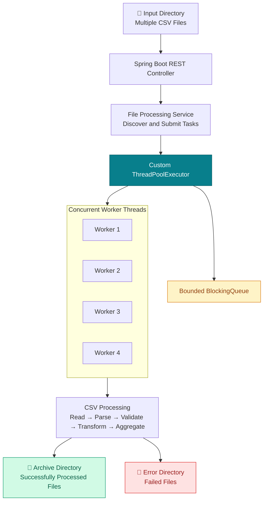

# ⚡ Concurrent CSV Processing System

**A multithreaded file processing application built with Java, Spring Boot, and a custom ThreadPoolExecutor to process multiple CSV files concurrently.**

<p align="left">
  
  
  
  
  
</p>

## 📌 Project Overview

The **Concurrent CSV Processing System** is a Spring Boot application designed to process multiple CSV files simultaneously using Java's multithreading capabilities.

Instead of processing files sequentially or creating a new thread for every file, the application uses a **custom-configured ThreadPoolExecutor** to manage a fixed number of reusable worker threads.

Each CSV file is submitted as an independent processing task. Available worker threads pick up tasks from a bounded queue and execute them concurrently.

The system reads CSV records, validates data, performs business transformations, generates processing summaries, and organizes completed and failed files into separate directories.

### 🎯 Project Goals

- Understand and implement Java multithreading in a practical backend application.
- Build and configure a custom thread pool using `ThreadPoolExecutor`.
- Process multiple files concurrently while controlling resource utilization.
- Implement reliable file handling and exception management.
- Expose file processing operations through REST APIs.
- Apply clean code principles and layered Spring Boot architecture.

## 🏗️ High-Level Architecture

The application follows a task-based processing architecture.



### ⚙️ Thread Pool Configuration

The initial implementation uses the following configuration:

| Configuration | Value | Description |
|---|---:|---|
| Core Pool Size | 4 | Number of core worker threads |
| Maximum Pool Size | 4 | Maximum concurrent worker threads |
| Queue Capacity | 10 | Maximum number of waiting tasks |
| Keep Alive Time | 0 seconds | Idle timeout for excess threads |
| Rejection Policy | AbortPolicy | Rejects tasks when capacity is exhausted |

**Total task capacity: 14 tasks** (4 executing + 10 queued).

The bounded queue prevents unlimited task accumulation and helps control memory consumption.

## 🛠️ Tech Stack

| Technology | Purpose |
|---|---|
| Java 17 | Core programming language |
| Spring Boot 3.x | Application framework and REST APIs |
| Maven | Build and dependency management |
| ThreadPoolExecutor | Custom thread pool management |
| BlockingQueue | Task queuing and coordination |
| Java NIO | File and directory operations |
| OpenCSV | CSV parsing and record handling |
| JUnit 5 | Unit testing |
| Mockito | Mocking dependencies in tests |
| SLF4J | Application logging |

## ✨ Functional Requirements

The application is designed around the following functional requirements:

### 1. CSV File Discovery
- Scan a configured input directory.
- Identify and collect CSV files.
- Ignore unsupported file formats.
- Prepare discovered files for concurrent processing.

### 2. Concurrent File Processing
- Submit individual files as independent tasks.
- Execute multiple file-processing tasks simultaneously.
- Use a custom thread pool with configurable worker threads.
- Maintain a bounded task queue.
- Handle task rejection when processing capacity is exhausted.

### 3. CSV Parsing and Validation
- Read CSV files and parse individual records.
- Validate mandatory fields and data types.
- Identify malformed or invalid records.
- Separate valid and invalid records during processing.

### 4. Business Data Processing
- Calculate total records processed.
- Calculate aggregate salary values.
- Generate average salary statistics.
- Produce a processing summary for each file.

### 5. File Management
- Move successfully processed files to the archive directory.
- Move failed files to the error directory.
- Handle file-related exceptions gracefully.
- Prevent accidental overwriting of existing files.

### 6. Processing Status and Monitoring
- Track individual file-processing status.
- Capture processing start and completion times.
- Maintain success and failure counts.
- Provide processing summaries through REST APIs.

## 📂 Project Structure

The project follows a layered architecture to maintain separation of concerns and improve maintainability.

```text
concurrent-file-processor/
│
├── src/
│   ├── main/
│   │   ├── java/com/example/fileprocessor/
│   │   │   │
│   │   │   ├── config/
│   │   │   │   └── ThreadPoolConfig.java
│   │   │   │
│   │   │   ├── controller/
│   │   │   │   └── FileProcessingController.java
│   │   │   │
│   │   │   ├── service/
│   │   │   │   ├── FileDiscoveryService.java
│   │   │   │   ├── FileProcessingService.java
│   │   │   │   └── CsvProcessingService.java
│   │   │   │
│   │   │   ├── processor/
│   │   │   │   └── CsvFileTask.java
│   │   │   │
│   │   │   ├── model/
│   │   │   │   ├── Employee.java
│   │   │   │   └── ProcessingResult.java
│   │   │   │
│   │   │   ├── exception/
│   │   │   │   └── FileProcessingException.java
│   │   │   │
│   │   │   └── FileProcessorApplication.java
│   │   │
│   │   └── resources/
│   │       └── application.yml
│   │
│   └── test/
│       └── java/com/example/fileprocessor/
│
├── input/       # Incoming CSV files
├── output/      # Generated processing results
├── archive/     # Successfully processed files
├── error/       # Failed files
│
├── pom.xml
└── README.md
```

## 🔄 Application Workflow

1. The client triggers file processing through a REST API.
2. The application scans the input directory and discovers available CSV files.
3. Each discovered file is wrapped into an independent processing task.
4. Tasks are submitted to the custom `ThreadPoolExecutor`.
5. Available worker threads retrieve tasks from the queue.
6. Each worker reads, parses, validates, and processes its assigned CSV file.
7. Processing results are generated and recorded.
8. Successfully processed files are moved to the archive directory.
9. Failed files are moved to the error directory.
10. Processing status and summary information are made available through REST APIs.

## 🚀 Getting Started

### Prerequisites

Ensure the following are installed:

- Java 17 or later
- Maven 3.8+
- IntelliJ IDEA / Eclipse / VS Code
- Git

### Clone the Repository

```bash
git clone https://github.com/<your-username>/concurrent-file-processor.git

cd concurrent-file-processor
```

### Build the Application

```bash
mvn clean install
```

### Run the Application

```bash
mvn spring-boot:run
```

### Prepare Input Files

Place your CSV files inside the `input/` directory.

Example:

```csv
id,name,department,salary
1,Rahul,IT,50000
2,John,HR,45000
3,David,IT,60000
4,Smith,Finance,55000
```

Trigger processing using the application's REST API once the processing endpoint is implemented.

## 🧠 Core Java Concepts Covered

This project provides hands-on experience with important Java concurrency concepts:

- Multithreading and thread lifecycle.
- `Runnable` and `Callable`.
- `ExecutorService` and `ThreadPoolExecutor`.
- `BlockingQueue` and producer-consumer concepts.
- Thread factories and custom thread naming.
- Atomic variables and thread safety.
- Exception handling in asynchronous tasks.
- Graceful thread pool shutdown.
- Task rejection and backpressure considerations.
- Concurrent execution and synchronization.

## 🧪 Testing Strategy

The project will include unit and integration tests covering:

- Thread pool configuration and worker execution.
- Concurrent processing of multiple CSV files.
- CSV parsing and validation.
- Handling malformed CSV records.
- File movement after successful and failed processing.
- Task rejection when the queue is full.
- Graceful shutdown of worker threads.
- REST API responses and processing status.

## 🗺️ Development Roadmap

- [x] Stage 1: Custom ThreadPoolExecutor configuration.
- [x] Stage 2: CSV file discovery using Java NIO.
- [x] Stage 3: Concurrent file processing using worker tasks.
- [ ] Stage 4: CSV parsing, validation, and business processing.
- [ ] Stage 5: Processing results and file management.
- [ ] Stage 6: REST APIs for processing and status tracking.
- [ ] Stage 7: Unit testing and concurrency testing.
- [ ] Stage 8: Error handling, graceful shutdown, and production improvements.

## 📚 Learning Outcomes

By completing this project, the objective is to gain practical knowledge of:

- How Java thread pools work internally.
- How to control concurrent task execution.
- How Spring Boot manages application-level executor beans.
- How to process files efficiently using Java NIO.
- How to design asynchronous backend workflows.
- How to handle failures in concurrent applications.

---

**Built with Java ☕ and a curiosity for understanding concurrency.**

⭐ If you find this project useful, feel free to explore, fork, and contribute!
